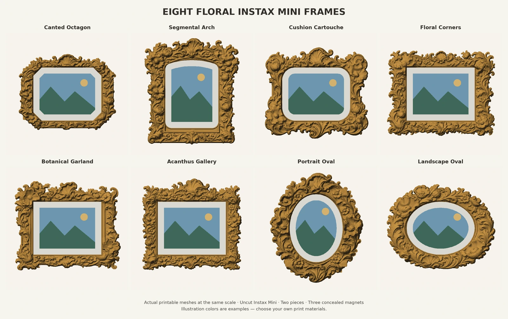
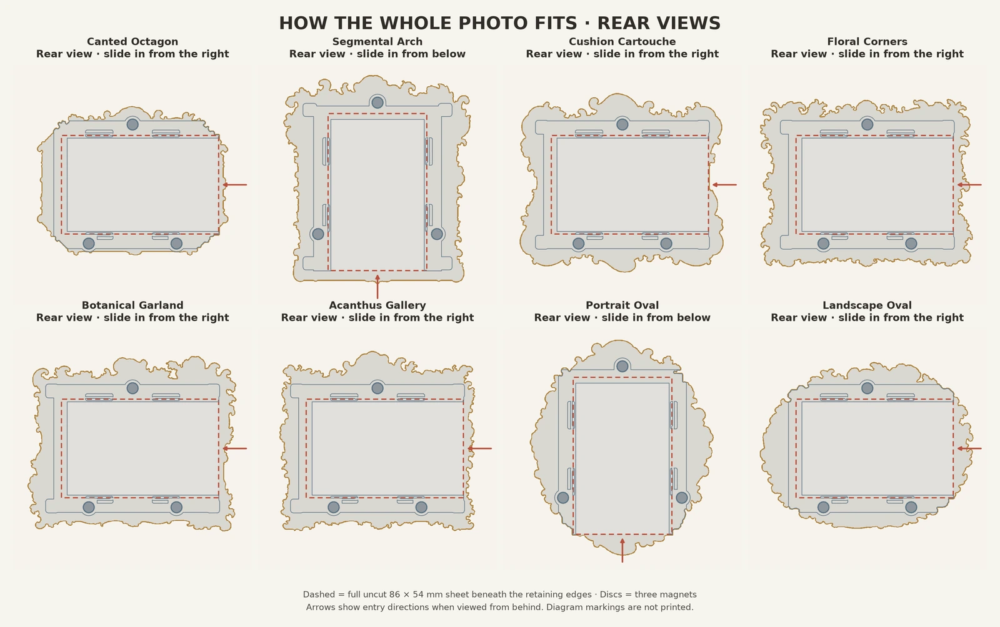

# Floral frames for Instax Mini

November 2026

I wanted ornate little frames for instant photos, with magnets so I could put
them on the fridge. That sounded like adding a hole to an existing frame. It
turned into a collection of eight designs, a photo-loading mechanism, and a
fair amount of thinking about flowers.

**[Browse the frames and download the files](https://obartra.github.io/baroque-instax-frames/)**
or download the collection on [MakerWorld](https://makerworld.com/en/models/3636176-rococo-instax-mini-magnetic-frames-8-designs) or [Printables](https://www.printables.com/model/1920140-rococo-instax-mini-magnetic-frames-8-designs).
The [source is on GitHub](https://github.com/obartra/baroque-instax-frames).

*Renders of the actual printable models. The landscapes are placeholders and
the colors are examples.*

## Start with the photo

The frames fit a whole **86 × 54 mm Instax Mini sheet**, including its white
border. The nominal image is 62 × 46 mm. I wanted the photo to slide in intact,
with no trimming and no glue on the film.

The first approach was to stretch the frame to fit. The opening improved, but
the artwork suffered: leaves and flowers stretched along with it. Uniformly
scaling the ornament preserved its proportions, but could make the surround
look enormous next to such a small picture.

The inner mat gave me another variable. It adds space between the photograph
and ornament, so a larger surround can conceal the film without distorting
the carving. It also gives the image a deliberate, even border instead of
exposing whatever strip of the original white margin happens to show.

There is still a tradeoff. An oval opening crops more of a rectangular image
than a rectangular opening does. The ovals keep their own silhouettes rather
than becoming rounded rectangles just to reveal a little more photograph.
The whole sheet stays inside; the aperture decides how much of its image is
visible. The film and carrier are concealed from the front, though the carrier
can be visible from a shallow side angle.

## A family of frames

The collection has three rectangular designs, a canted octagon, a segmental
arch, a cushion cartouche, and portrait and landscape ovals.

I wanted busy ornament and large flowers, but not a repeated flower stamped
around every edge. Making the landscape oval a rotated portrait oval looked
forced. It needed a composition that worked horizontally, with a different
distribution of flowers, leaves and scrolls.

The historical direction became French floral Rococo, roughly 1735–1750.
Research included a [frame attributed to a design by Juste Aurèle Meissonnier
at The Met](https://www.metmuseum.org/art/collection/search/209073) and the
Getty's [*Louis Style: French Frames 1610–1792*](https://www.getty.edu/art/exhibitions/french_frames/LFF_Online_Gallery_Graphics.pdf).
These are new, historically informed compositions with modern photo holders,
rather than reproductions of documented antique frames.

## From a drawing to a printable object

The current ornament started with AI-generated carving studies. Cached depth
and surface-normal guidance helped interpret those drawings as relief, followed
by CAD work on the surfaces, mouldings and functional parts. The current
catalog does not reuse the downloaded ornamental meshes from the initial
experiment. The project's [provenance record](https://github.com/obartra/baroque-instax-frames/blob/main/PROVENANCE.txt)
documents the inputs and process.

A drawing can suggest a petal floating over another petal. A filament printer
needs something to put underneath it. The flowers therefore use supported
petal bowls, short overlap channels and connected center relief instead of
isolated fine filaments. AI historian-role and product-design reviews helped
critique the compositions; those reviews are design feedback, not historical
authentication or a substitute for printing.

The catalog previews now come from the actual meshes. Front views show the
composition; upright angled views show the depth; rear views explain how the
whole film fits. That makes it easier to compare the design with what will
actually go to the slicer.

## What the prints changed

Some of the useful changes came from handling the parts:

- **The wider mats needed more thickness.** They bent and showed stress during
  removal from the plate. The current mats are 0.68 mm thick instead of
  0.36 mm: seven layers with the supplied layer heights.
- **One magnet was not stable enough.** Each back now has three pockets for
  6 mm diameter × 3 mm thick magnets, spread around the carrier.
- **The clips only need to engage once.** The intended assembly can be glued
  after seating, so repeatedly opening and closing brittle clips was not the
  right design target.

Each design has a matching back. The pair joins while empty, then the photo
slides into the channel: from the left for landscape frames, or from below
for portrait frames. The back supports the photo while keeping its carrier
inside the front silhouette.

*Rear views of the actual models. Dashed outlines show the full uncut sheet;
arrows show the entry side when viewed from behind.*

## Making one

Each design has two download options:

| Format | What it includes |
| --- | --- |
| **3MF** | A Bambu Studio project with the matching front and back on two plates, material assignments, and a supplied P2S / 0.4 mm profile |
| **STL ZIP** | Aligned mat and ornament meshes plus the matching back, for use with your own slicer and printer profiles |

The mat and ornament print together as **one physical front**. They can use
the same filament, or two colors. STL has no color instructions, so a multicolor
slicer needs a filament assigned to each region. For a manual swap with a
0.20 mm first layer and 0.08 mm subsequent layers, finish the mat at layer 7
(0.68 mm), then change before layer 8 (0.76 mm). Other layer heights need a
different layer number; check the boundary in the sliced preview.

Print the back separately, glue the three magnets into its pockets, join the
empty frame, let any assembly adhesive cure, and slide in the photo. It can go
on any suitable magnet-attracting surface, not just a fridge.

The [illustrated guide and downloads](https://obartra.github.io/baroque-instax-frames/#choose-a-frame)
live with the collection. Models, renders and documentation are offered under
CC0, within the project's [license scope](https://github.com/obartra/baroque-instax-frames/blob/main/LICENSING.md);
the code is MIT. Use them, change them, and share what you make.
